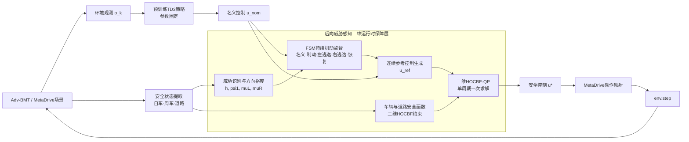

# 3 面向对抗追尾场景的二维运行时保障方法

本文针对预训练驾驶策略在非合作式对抗追尾场景中缺乏主动自我保护能力的问题，提出一种有限状态监督的二维高阶控制障碍函数运行时保障方法。该方法不改变原始TD3策略的网络参数、训练流程和奖励函数，而是在策略执行阶段对其输出动作进行实时安全修正。具体而言，系统首先依据周围车辆与道路状态识别前向和后向威胁，并评估左右逃逸空间；随后由有限状态监督器形成具有时间持续性的机动意图；最后通过二维HOCBF-QP联合修正纵向加速度和横向曲率，在规避后向追尾风险的同时约束前车、侧向交通及道路边界风险。

## 3.1 总体框架

所提运行时保障层部署于预训练TD3策略与MetaDrive车辆执行接口之间，其总体结构如图1所示。在离散控制时刻 $k$，预训练TD3策略根据环境观测 $o_k$ 输出名义动作

$$
a_k^{\mathrm{TD3}}=\pi_\theta(o_k),
\tag{1}
$$

其中，$\pi_\theta$ 表示训练完成且在评估阶段保持参数固定的策略网络。名义动作经物理量映射后表示为

$$
u_k^{\mathrm{nom}}
=
\begin{bmatrix}
a_k^{\mathrm{nom}} & \kappa_k^{\mathrm{nom}}
\end{bmatrix}^{\mathrm T},
\tag{2}
$$

其中，$a$ 为纵向加速度，$\kappa$ 为路径曲率。运行时保障层同时接收自车状态、周围交通参与者状态以及道路几何信息，并将名义控制修正为

$$
u_k^*=\mathcal F_{\mathrm{RTA}}
\left(u_k^{\mathrm{nom}},x_k,\mathcal V_k,\mathcal R_k\right),
\tag{3}
$$

其中，$x_k$、$\mathcal V_k$ 和 $\mathcal R_k$ 分别表示自车状态、周围交通参与者集合和局部道路状态。安全控制 $u_k^*$ 随后被重新映射为MetaDrive动作并输入原生环境。关闭运行时保障层后，评估过程可直接恢复为原始TD3执行路径，因此该方法能够作为独立插件作用于已经训练完成的驾驶策略。

运行时保障层由机动监督和连续安全修正两个相互配合的部分组成。机动监督部分根据后向威胁和左右安全裕度形成名义行驶、制动、左向逃逸、右向逃逸及航向恢复等持续机动状态；连续安全修正部分则根据车辆和道路安全函数构造HOCBF约束，并在当前机动参考附近求解二维QP。前者解决追尾规避过程中逃逸方向的选择与保持问题，后者负责将机动意图转化为满足实时安全约束的连续控制量。

## 3.2 后向威胁感知与持续机动决策

为统一描述车辆纵向接近和横向分离过程，本文在道路局部坐标系中构造二维车辆安全包络。设 $t$ 和 $n$ 分别表示道路切向与左法向，自车与交通参与者 $i$ 的相对纵向、横向位置分别为

$$
s_i=(p_e-p_i)^{\mathrm T}t,
\qquad
d_i=(p_e-p_i)^{\mathrm T}n.
\tag{4}
$$

综合考虑自车与目标车辆的尺寸、航向投影及附加安全余量，分别得到纵向包络尺度 $R_{s,i}$ 和横向包络尺度 $R_{d,i}$，进而定义二维超椭圆安全函数

$$
h_i(x)
=
\left[
\left(\frac{s_i}{R_{s,i}}\right)^4
+
\left(\frac{d_i}{R_{d,i}}\right)^4
+\varepsilon
\right]^{1/4}
-(1+\varepsilon)^{1/4},
\tag{5}
$$

其中，$\varepsilon>0$ 为数值正则项。当 $h_i\geq0$ 时，两车位于组合碰撞包络之外。进一步定义

$$
\psi_{1,i}=\dot h_i+\alpha_1h_i,
\tag{6}
$$

使威胁判断同时包含当前空间余量及其变化趋势。对于位于自车后方的车辆，当其满足

$$
h_i\leq h_{\mathrm{in}}
\quad\text{或}\quad
\psi_{1,i}\leq\psi_{\mathrm{in}}
\tag{7}
$$

时，系统将其视为潜在后向追尾威胁；只有当 $h_i$ 和 $\psi_{1,i}$ 同时恢复至退出阈值以上时，才判定威胁解除。进入阈值与退出阈值之间设置滞回区间，以避免临界状态附近频繁触发和解除安全机动。

检测到后向威胁后，系统分别评估左右方向的道路剩余空间以及虚拟横向目标位置处的车辆安全裕度，并将道路边界、侧向车辆和相应安全状态中的最小值作为该方向的综合安全裕度 $\mu_L$ 和 $\mu_R$。若仅有一个方向满足最低安全条件，则选择该方向；若两个方向均可行，则选择安全裕度较大的方向；若左右均不存在可行空间，则进入纵向制动状态。

为保持机动行为在连续控制周期内的一致性，定义有限状态集合

$$
\mathcal Q
=
\{q_N,q_B,q_L,q_R,q_C\},
\tag{8}
$$

其中，$q_N$、$q_B$、$q_L$、$q_R$ 和 $q_C$ 分别表示名义行驶、制动、左向逃逸、右向逃逸和航向恢复状态。状态转移综合使用威胁进入与退出阈值、最小驻留时间、连续安全计数和方向滞回。当威胁解除后，系统首先进入航向恢复状态，在车辆航向逐渐回归道路方向后返回名义行驶状态；若恢复过程中再次出现危险，则可重新进入对应的安全机动状态。

有限状态监督器不直接指定若干固定动作，而是根据当前状态生成单个连续参考控制

$$
u_k^{\mathrm{ref}}(q_k)
=
\begin{bmatrix}
a_k^{\mathrm{ref}}(q_k) &
\kappa_k^{\mathrm{ref}}(q_k)
\end{bmatrix}^{\mathrm T}.
\tag{9}
$$

在名义状态下，该参考保持TD3的原始控制；在左右逃逸状态下，根据所选方向、当前道路余量和航向误差生成连续曲率参考；在制动状态下，根据前向风险程度对名义加速度进行自适应限制；在恢复状态下，通过航向误差反馈逐渐消除逃逸机动产生的偏航。由此，有限状态监督器负责确定“采取何种持续机动”，而不直接替代后续安全优化器计算最终动作。

## 3.3 二维HOCBF-QP安全动作修正

自车状态定义为 $x=[p_x,p_y,v,\theta]^{\mathrm T}$。采用以纵向加速度和路径曲率为输入的二维运动学模型

$$
\dot p=ve(\theta),
\qquad
\dot v=a,
\qquad
\dot\theta=v\kappa,
\tag{10}
$$

其中，$e(\theta)=[\cos\theta,\sin\theta]^{\mathrm T}$。由此可得平面加速度

$$
\ddot p
=ae(\theta)+v^2\kappa e_\perp(\theta),
\tag{11}
$$

其中，$e_\perp(\theta)=[-\sin\theta,\cos\theta]^{\mathrm T}$。式（11）使加速度 $a$ 和曲率 $\kappa$ 同时进入安全约束，从而支持纵向减速、纵向加速与横向逃逸的联合修正。

由于式（5）所定义的位置安全函数相对于控制输入具有二阶相对度，进一步构造

$$
\psi_{2,i}
=
\dot\psi_{1,i}+\alpha_2\psi_{1,i}
=
\ddot h_i
+(\alpha_1+\alpha_2)\dot h_i
+\alpha_1\alpha_2h_i.
\tag{12}
$$

将车辆运动学代入 $\psi_{2,i}\geq0$ 后，可得到关于控制输入的仿射安全约束

$$
A_i(x)u\geq b_i(x),
\qquad i\in\mathcal I_{\mathrm{veh}},
\tag{13}
$$

其中，$\mathcal I_{\mathrm{veh}}$ 包含当前激活的前车、后车和侧向交通参与者。道路安全函数根据自车车身在道路法向上的实时投影尺寸，以及自车至左右道路边界的保守距离构造，并相应形成道路HOCBF约束

$$
A_j^{\mathrm{road}}(x)u
\geq
b_j^{\mathrm{road}}(x),
\qquad j\in\{L,R\}.
\tag{14}
$$

在每个控制周期内，运行时保障层求解一次二维二次规划

$$
\begin{aligned}
u_k^*=\arg\min_u\quad&
\frac{1}{2}
\left(u-u_k^{\mathrm{ref}}\right)^{\mathrm T}
W
\left(u-u_k^{\mathrm{ref}}\right)\\
\mathrm{s.t.}\quad&
A_i(x_k)u\geq b_i(x_k),
\quad i\in\mathcal I_{\mathrm{veh}},\\
&A_j^{\mathrm{road}}(x_k)u
\geq b_j^{\mathrm{road}}(x_k),
\quad j\in\{L,R\},\\
&a_{\min}\leq a\leq a_{\max},\\
&-\kappa_{\max}\leq\kappa\leq\kappa_{\max},
\end{aligned}
\tag{15}
$$

其中，$W\succ0$ 为控制偏差权重矩阵。该优化在满足车辆、道路和执行器约束的条件下，使最终控制尽可能接近当前机动状态所给出的参考控制。当前方、后方、侧向车辆与道路约束同时存在时，它们被统一纳入同一二维安全可行域，从而避免自车在规避后方追尾过程中将风险转移至其他交通参与者或道路边界。若安全约束不存在公共解，系统根据车辆碰撞风险和道路恢复状态进行分级松弛，并记录相应的不可行状态和约束违背程度。

综上，所提方法以有限状态监督器形成具有时间持续性的主动逃逸意图，以二维HOCBF-QP完成连续安全动作修正。两者分别承担机动决策与安全控制功能，并共同构成面向对抗追尾场景的插件式运行时保障层。

---

## 图1绘制说明（不属于论文正文）

总体框架图建议采用“主控制链 + RTA内部双分支”的横向结构：上方主链突出预训练TD3不被修改，下方RTA模块分为机动监督分支和安全约束分支，并在二维HOCBF-QP处汇合。

正式论文作图时可将“预训练TD3策略”使用蓝色，“FSM持续机动监督”使用橙色，“二维HOCBF安全约束与QP”使用绿色，环境和动作映射使用灰色。图中应保留以下信息：

1. TD3参数在评估阶段固定，RTA不参与训练；
2. 环境状态同时进入TD3和RTA状态提取模块；
3. RTA内部存在“机动参考”和“安全约束”两条支路；
4. 两条支路在二维HOCBF-QP处汇合；
5. 最终输出为纵向加速度与横向曲率的联合安全控制；
6. 安全动作输入原生MetaDrive环境并形成闭环。

图题建议为：

> 图1 面向对抗追尾场景的有限状态监督二维HOCBF-QP运行时保障框架

